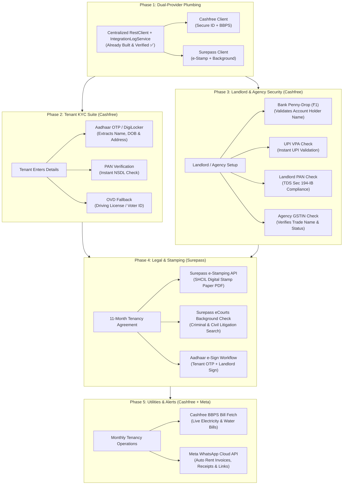

Here is the architectural roadmap structured across **5 clear phases**, ensuring that neither the **Tenant**, the **Landlord**, nor the **Agency** ever encounters friction or dead ends:

---

### Detailed Implementation Phases

#### **Phase 1: Dual-Provider Client Infrastructure (Days 1–2)**
* **Deliverable**: Robust HTTP service wrappers for Cashfree and Surepass with automatic audit logging to `integration_logs`.
* **Components**:
  1. `CashfreeHttpClient`: Handles Cashfree auth headers (`x-client-id`, `x-client-secret`, `x-api-version`).
  2. `SurepassHttpClient`: Handles Surepass Bearer Token authorization.
  3. Reusable error handler mapping third-party 4xx/5xx responses into our clean `ApiResponse<T>`.

---

#### **Phase 2: Tenant KYC & Identity Stack (Cashfree Secure ID) (Days 3–5)**
* **Goal**: Frictionless tenant onboarding with multiple verification choices.
* **Step 2.1 — Aadhaar OTP / DigiLocker Verification**:
  - Endpoint: `POST /api/v1/kyc/aadhaar/generate-otp` & `POST /api/v1/kyc/aadhaar/verify-otp`.
  - Behavior: Cashfree sends OTP to tenant's mobile; upon verification, backend captures verified full name, date of birth, gender, and address. Stores masked `id_proof_last4` and encrypts Aadhaar with AES-256.
* **Step 2.2 — Instant PAN Verification**:
  - Endpoint: `POST /api/v1/kyc/pan/verify`.
  - Behavior: Checks PAN validity against NSDL and returns the registered legal name.
* **Step 2.3 — OVD Fallback (Driving License / Voter ID)**:
  - If a tenant does not have their Aadhaar mobile handy, they can enter their DL or Voter ID number, which Cashfree verifies instantly against state transport and ECI databases.

---

#### **Phase 3: Landlord Trust & Payout Security (Cashfree Secure ID) (Days 6–8)**
* **Goal**: 100% fraud protection before rent money is disbursed to landlords.
* **Step 3.1 — Bank Account Penny-Drop Verification**:
  - Endpoint: `POST /api/v1/verification/bank-account`.
  - Behavior: Cashfree deposits ₹1 into the landlord's account via IMPS. NPCI returns the registered account holder name. Backend verifies the bank name matches `landlords.legal_name`.
* **Step 3.2 — UPI VPA Verification**:
  - Endpoint: `POST /api/v1/verification/upi`.
  - Behavior: Instant check of Landlord's UPI VPA (e.g. `landlord@okhdfcbank`) before payout.
* **Step 3.3 — Landlord PAN Check**:
  - Validates landlord PAN for Section 194-IB TDS reporting.
* **Step 3.4 — Agency GSTIN & KYB**:
  - Endpoint: `POST /api/v1/verification/gstin`.
  - Validates Agency trade name, legal status, and registered address from the GST portal to auto-fill branding settings.

---

#### **Phase 4: Legal Stamping, Background Check & e-Sign (Surepass) (Days 9–12)**
* **Goal**: 100% paperless, legally binding digital rental agreement and safety clearance.
* **Step 4.1 — State e-Stamp Procurement (Surepass e-Stamping API)**:
  - Endpoint: `POST /api/v1/leases/{id}/e-stamp`.
  - Behavior: Calls Surepass with Landlord/Tenant details, State code (e.g. `KA`, `MH`, `DL`), and Stamp Duty amount (₹100/₹500). Generates official SHCIL e-stamp certificate number and downloads the certificate PDF.
* **Step 4.2 — Criminal & Court Background Check (Surepass eCourts API)**:
  - Endpoint: `POST /api/v1/tenants/{id}/police-verification`.
  - Behavior: Searches District Courts and High Courts across India for active FIRs, criminal cases, or civil disputes. Saves report into `police_verifications.metadata` and generates the Police Verification dossier.
* **Step 4.3 — Dual-Party Aadhaar e-Sign**:
  - Merges the e-stamp certificate with the generated agreement PDF, sends Aadhaar OTP signing requests to tenant and landlord, and records signed PDF into `esign_transactions`.

---

#### **Phase 5: Utilities & WhatsApp Automation (Days 13–15)**
* **Step 5.1 — Cashfree BBPS Utility Bill Fetch**:
  - Endpoint: `POST /api/v1/bbps/fetch-bill`.
  - Behavior: Passes `biller_id` (e.g., BESCOM Electricity) and `consumer_number`. Receives exact bill amount, bill date, and due date. Auto-populates the monthly tenant invoice.
* **Step 5.2 — Meta WhatsApp Cloud API**:
  - Dispatches automated WhatsApp template messages with rent invoices, payment links, and PDF receipts.

---
